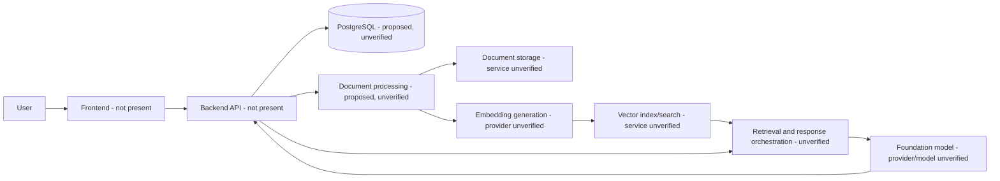

# Nirmaya AI V2

Nirmaya AI V2 is intended to become an AI-powered healthcare technology platform for document processing, semantic retrieval, and context-aware AI experiences. The current repository is an initial scaffold: it contains this README and an MIT license, but no application source, dependency manifests, infrastructure definitions, database schema, or tests.

This distinction matters. AWS, Amazon Bedrock, vector search, and PostgreSQL are part of the project brief, but none of those integrations is implemented or configured in the checked-in files at this time. This document records what can be verified and identifies the information needed before the architecture or setup can be treated as operational.

## Status at a glance

| Area | Repository evidence | Status |
| --- | --- | --- |
| Product direction | Healthcare-focused AI document processing and retrieval described in the project brief | Intended; implementation not present |
| Frontend and API | No application source or API specification | Not present |
| AWS services | No infrastructure code, SDK configuration, or deployment manifests | Not verified; not present in repository |
| Bedrock models and inference | No model identifiers or inference code | Not verified; not implemented in repository |
| Embeddings and vector search | No embedding pipeline, vector index, or retrieval code | Not verified; not implemented in repository |
| PostgreSQL | No connection configuration, schema, ORM models, or migrations | Not verified; not implemented in repository |
| Tests, lint, and build | No test or tooling configuration | No project commands available |
| License | Root `LICENSE` | MIT License |

## Product objectives

The stated direction is to support healthcare document workflows and intelligent information retrieval. A complete implementation may eventually include ingestion, parsing, chunking, indexing, search, and AI-assisted responses. These are product objectives only: the current repository does not establish which workflows exist, what data they accept, or what outputs they produce.

## Architecture and implementation boundary

There is no verifiable runtime architecture yet. The diagram below shows the proposed conceptual flow implied by the project brief; it is not a description of deployed or implemented components. Service names and boundaries must be updated when source code and infrastructure are added.

No component boundaries, network paths, queues, failure handling, or security controls can be confirmed from the checked-in project. In a future implementation, document authentication and authorization at each boundary, encryption in transit and at rest, tenant or patient data isolation, retry and idempotency behavior, and the effect of dependency outages. Do not treat this conceptual diagram as an approved deployment design.

## Technology and AWS services

The project brief names AWS, Amazon Bedrock, vector search, and PostgreSQL as intended technologies. The repository does not include dependency declarations, code, or infrastructure that verifies any specific AWS service or database product. In particular, it does not establish use of S3, OpenSearch, Aurora, RDS, Lambda, ECS, EKS, or any other named AWS service.

There are no confirmed AWS regions, accounts, authentication methods, IAM roles, permissions, network rules, or encryption settings. No credentials or environment variables are documented because none are defined in the repository.
