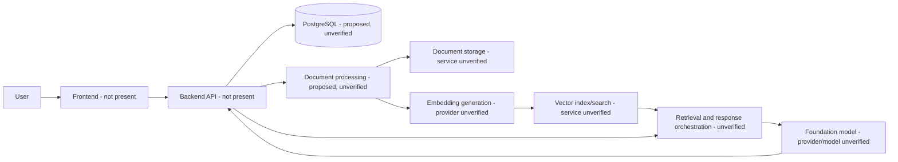

# Nirmaya AI V2

Nirmaya AI V2 is intended to become an AI-powered healthcare technology platform for document processing, semantic retrieval, and context-aware AI experiences. The current repository is an initial scaffold: it contains this README and an MIT license, but no application source, dependency manifests, infrastructure definitions, database schema, or tests.

This distinction matters. AWS, Amazon Bedrock, vector search, and PostgreSQL are part of the project brief, but none of those integrations is implemented or configured in the checked-in files at this time. This document records what can be verified and identifies the information needed before the architecture or setup can be treated as operational.

## Status at a glance

| Area | Repository evidence | Status |
| --- | --- | --- |
| Product direction | Healthcare-focused AI document processing and retrieval described in the project brief | Intended; implementation not present |
| Frontend and API | No application source or API specification | Not present |
| AWS services | No infrastructure code, SDK configuration, or deployment manifests | Not verified; not present in repository |
| Bedrock models and inference | No model identifiers or inference code | Not verified; not implemented in repository |
| Embeddings and vector search | No embedding pipeline, vector index, or retrieval code | Not verified; not implemented in repository |
| PostgreSQL | No connection configuration, schema, ORM models, or migrations | Not verified; not implemented in repository |
| Tests, lint, and build | No test or tooling configuration | No project commands available |
| License | Root `LICENSE` | MIT License |

## Product objectives

The stated direction is to support healthcare document workflows and intelligent information retrieval. A complete implementation may eventually include ingestion, parsing, chunking, indexing, search, and AI-assisted responses. These are product objectives only: the current repository does not establish which workflows exist, what data they accept, or what outputs they produce.

## Architecture and implementation boundary

There is no verifiable runtime architecture yet. The diagram below shows the proposed conceptual flow implied by the project brief; it is not a description of deployed or implemented components. Service names and boundaries must be updated when source code and infrastructure are added.



No component boundaries, network paths, queues, failure handling, or security controls can be confirmed from the checked-in project. In a future implementation, document authentication and authorization at each boundary, encryption in transit and at rest, tenant or patient data isolation, retry and idempotency behavior, and the effect of dependency outages. Do not treat this conceptual diagram as an approved deployment design.

## Technology and AWS services

The project brief names AWS, Amazon Bedrock, vector search, and PostgreSQL as intended technologies. The repository does not include dependency declarations, code, or infrastructure that verifies any specific AWS service or database product. In particular, it does not establish use of S3, OpenSearch, Aurora, RDS, Lambda, ECS, EKS, or any other named AWS service.

There are no confirmed AWS regions, accounts, authentication methods, IAM roles, permissions, network rules, or encryption settings. No credentials or environment variables are documented because none are defined in the repository.

## Bedrock, embeddings, and semantic retrieval

There are no configured foundation model or embedding model IDs, inference calls, prompt templates, token limits, retry policies, or model response handling in the repository. It is not possible to say whether inference or embeddings use Bedrock or another provider.

No chunking strategy, embedding dimensions, vector database, similarity metric, index configuration, metadata filters, access controls, or source attribution behavior is present. RAG, citations, and retrieval-grounded response generation are therefore unverified and should not be described as available features.

## Data layer and document pipeline

No PostgreSQL connection settings, SQLAlchemy models, schema, relationships, transaction management, connection pooling, or Alembic migrations are checked in. There is no database initialization or migration command to run. Avoid creating or modifying a database based on assumptions; add a reviewed schema and migration workflow first.

Likewise, no document upload endpoint, file validation, malware scanning, OCR or parsing, queue/worker, object storage, retention policy, or deletion workflow is present. Accepted formats, size limits, processing guarantees, and data lifecycle behavior are unknown.

## Repository layout

```text
.
├── LICENSE
└── README.md
```

This is the complete tracked project structure at the time of writing. The local `.venv` directory is a development environment and is not part of the tracked source listing.

## Prerequisites and local setup

Python 3.13.4 was available in the workspace when this README was prepared. No Python package manifest or application entry point is present, so creating a virtual environment is the only currently verifiable Python setup step.

```bash
python3 --version
python3 -m venv .venv
```

Activate it with the command for your shell:

```bash
# macOS / Linux (bash or zsh)
source .venv/bin/activate

# Windows PowerShell
.venv\Scripts\Activate.ps1
```

There are no dependencies to install from this repository and no server command to run. Once a dependency manifest and application entry point are added, document the supported Python version, install command, and launch command here. Do not copy secrets into this README.

## Configuration

The repository defines no environment variables or configuration files. A safe example cannot be supplied without knowing the application’s actual configuration interface. When configuration is introduced, commit a placeholder-only `.env.example`, validate required settings at startup, and keep real `.env` files and credentials out of version control. Prefer managed identity or short-lived credentials for cloud access where supported; do not embed long-lived AWS keys in source code.

## API, tests, linting, and builds

No API routes, OpenAPI document, test suite, linter, formatter, or build configuration is present. There are no repository-backed commands for API inspection, testing, linting, or building. Add these alongside the relevant application code and update this section with commands that have been run successfully.

## Security, privacy, and operational readiness

This repository does not implement or demonstrate authentication, authorization, encryption, audit logging, secret management, backups, monitoring, alerting, incident response, or data retention. It provides no basis for claiming that healthcare information is protected or that the platform meets HIPAA or any other regulatory requirement. Compliance depends on the actual system, operating processes, contracts, and applicable jurisdiction; it cannot be inferred from the product description or technology choices.

Before processing real or sensitive health data, establish and review at least:

- Data classification, permitted use, retention, deletion, and backup policies.
- Identity and least-privilege access controls for users, services, and operators.
- Encryption and key management for stored data, backups, and network traffic.
- Tenant and patient-level isolation for records, retrieval results, and logs.
- Safe logging and tracing that avoid storing document contents or sensitive identifiers unnecessarily.
- Dependency and image management, vulnerability response, audit trails, and incident procedures.
- Tested restore, outage, retry, and data deletion behavior.
- Applicable privacy, security, and healthcare regulatory reviews before production use.

These are readiness areas, not guarantees provided by the current scaffold.
