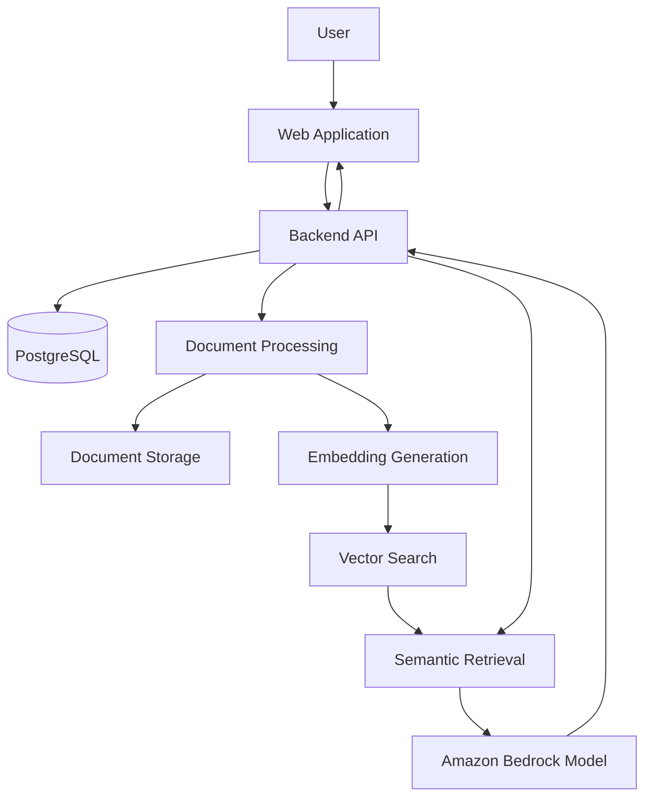

# Nirmaya AI V2

<p align="center">
  
</p>

<p align="center">
  <strong>Engineering a scalable foundation for AI-assisted healthcare information workflows.</strong>
  <br />
  <sub>Version 2 · AI Infrastructure · Cloud Engineering</sub>
</p>

<p align="center">
  
  
</p>

---

## Overview

Nirmaya AI V2 is an AI-powered healthcare technology platform envisioned to support document processing, semantic information retrieval, and context-aware AI experiences through a modular and maintainable architecture.

The project direction includes AWS services, Amazon Bedrock foundation models, vector search, and PostgreSQL. The repository currently represents an initial scaffold; these integrations should be considered planned or unverified until their implementation is available in the codebase.

## Engineering Principles

- **Modular architecture:** Keep system components maintainable and clearly separated.
- **Data integrity:** Design reliable persistence and controlled data lifecycle workflows.
- **AI-enabled retrieval:** Build toward semantic search and context-aware model interactions.
- **Security by design:** Prioritize least-privilege access, secret management, and data isolation.
- **Cloud readiness:** Establish a foundation for observable, resilient, and cost-aware infrastructure.

## Current Project Status

| Component | Status |
|---|---|
| Product architecture | In planning |
| Frontend and backend | Not present in the current scaffold |
| AWS integrations | Require implementation verification |
| Amazon Bedrock inference | Requires implementation verification |
| Embeddings and vector search | Requires implementation verification |
| PostgreSQL schema and migrations | Not present in the current scaffold |
| Automated tests and CI | Not configured in the current scaffold |

## Proposed Architecture

The following diagram represents a conceptual target architecture, not a deployed system.



Actual components, service boundaries, and data flows must be verified as implementation progresses.

## Technology Direction

| Technology | Intended purpose |
|---|---|
| AWS | Cloud infrastructure and managed services |
| Amazon Bedrock | Foundation-model inference and potentially embedding generation |
| Vector search | Semantic indexing and retrieval |
| PostgreSQL | Relational data persistence |
| Web application | User-facing workflows |
| Backend API | Business logic and service orchestration |

The exact AWS services, model identifiers, vector engine, and application frameworks must be documented from the actual implementation. Do not assume a particular AWS service is deployed without evidence.

## Repository Structure

The current repository contains the initial documentation and license:

```text
.
├── LICENSE
└── README.md
```

Update this section as application source code, configuration, migrations, tests, and infrastructure definitions are added.

## Getting Started

### Prerequisites

- Git
- Python, if required by the future backend implementation
- Node.js, if required by the future frontend implementation
- AWS account and permissions, when cloud integrations are implemented
- PostgreSQL, when database integration is implemented

### Clone the Repository

```bash
git clone https://github.com/singhdeepesh20/Nirmaya-AI-Version-2.git
cd Nirmaya-AI-Version-2
```

Open the project in Visual Studio Code:

```bash
code .
```

The current scaffold does not contain application dependencies or a runnable application entry point. Add verified installation and startup instructions when those components are available.

## AWS and AI Architecture

Future implementation documentation should identify:

- The AWS services actually used.
- Amazon Bedrock model IDs and inference configuration.
- Embedding generation and vector index configuration.
- IAM permissions and credential management.
- Document storage and access-control boundaries.
- Logging, monitoring, and operational error handling.

Use least-privilege IAM policies and avoid embedding long-lived credentials in source code.

## PostgreSQL and Data Management

The database implementation should document its schema, ORM models, migration workflow, transaction handling, connection management, and backup and recovery procedures.

No database schema or migration commands are currently verified in the scaffold. Do not run destructive database operations against any environment.

## Security and Privacy

Security requirements should be designed and validated before processing sensitive healthcare information:

- Authentication and authorization.
- Encryption in transit and at rest.
- Least-privilege access and secret management.
- Patient and tenant data isolation.
- Safe logging and audit trails.
- Data retention, deletion, backup, and recovery.
- Applicable privacy and regulatory reviews.

This repository does not currently demonstrate these controls or establish regulatory compliance.

## Roadmap

- [ ] Define application architecture and API contracts.
- [ ] Implement frontend and backend services.
- [ ] Verify and integrate AWS services.
- [ ] Integrate Amazon Bedrock models where required.
- [ ] Implement document processing and semantic retrieval.
- [ ] Establish PostgreSQL schema and migrations.
- [ ] Add automated tests and CI workflows.
- [ ] Implement monitoring, security controls, and recovery procedures.
- [ ] Validate deployment and operational readiness.

## Contributing

Contributions should prioritize clear design, maintainability, security, and reproducible development workflows. Document configuration changes and include appropriate tests as implementation evolves.

## License

This project includes an MIT License. See the [LICENSE](LICENSE) file for details.

---

<p align="center">
  <sub>Built with an emphasis on engineering rigor, responsible AI, and maintainable architecture.</sub>
</p>
## License

This project is distributed under the [MIT License](LICENSE).
