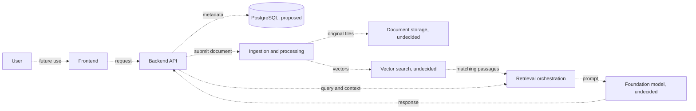

# Nirmaya AI V2

<p align="center">
  
</p>

<p align="center">
  <strong>Engineering a scalable foundation for AI-assisted healthcare information workflows.</strong>
  <br />
  <sub>Version 2 · AI Infrastructure · Cloud Engineering</sub>
</p>

<p align="center">
  
  
</p>

---

### Overview

Nirmaya AI V2 is an early-stage project for exploring AI-assisted healthcare document workflows and information retrieval. The product direction mentions document processing, semantic search, and context-aware AI experiences.

> **Current repository status:** this is a documentation scaffold. It contains a README and MIT license, but no running application, dependencies, database schema, cloud infrastructure, or AI integration. AWS, Amazon Bedrock, vector search, and PostgreSQL are named in the project brief as intended technologies; no implementation of them is present here.

### Contents

- [Engineering principles](#engineering-principles)
- [Project status](#project-status)
- [Architecture concept](#architecture-concept)
- [Technology direction](#technology-direction)
- [AI, embeddings, and retrieval](#ai-embeddings-and-retrieval)
- [Data and document lifecycle](#data-and-document-lifecycle)


## Engineering principles

These principles describe the intended direction for implementation:

- **Modularity:** define clear boundaries between user experience, APIs, data, and AI services.
- **Data integrity:** make persistence and document lifecycle explicit and reviewable.
- **Grounded AI:** design retrieval and source tracking so responses can be evaluated against their inputs.
- **Security by design:** plan for least-privilege access, secret handling, and data isolation before sensitive data is introduced.
- **Operability:** include observability, recovery, and cost controls when infrastructure is selected.

## Project status

| Area | Evidence in this repository | Status |
| --- | --- | --- |
| Application | No frontend, backend, worker, or API source files | Not implemented |
| AWS and Bedrock | No SDK configuration, model IDs, or infrastructure definitions | Not verified or configured |
| Embeddings and vector search | No embedding code, index, or retrieval implementation | Not implemented |
| PostgreSQL | No connection settings, schema, ORM models, or migrations | Not implemented |
| Developer tooling | No dependency manifest, test suite, or build configuration | Not present |
| License | Root `LICENSE` file | MIT |

The tracked repository consists of `README.md` and `LICENSE`. Update this table and the setup instructions as implementation is added.

## Architecture concept

The diagram is a **proposed concept**, not a deployed or implemented architecture. Dashed arrows show possible future interactions. Storage, vector search, model inference, and service boundaries remain undecided.



No queues, network topology, failure handling, or authorization flow can be verified yet. An implementation should define component ownership, check access before retrieval, handle partial failures and retries, and retain enough source information to inspect how a response was produced.

## Technology direction

The project brief names AWS, Amazon Bedrock, vector search, and PostgreSQL as intended technologies. The repository does not confirm a specific cloud service, database product, or application framework. In particular, there is no evidence here of S3, OpenSearch, Aurora, RDS, Lambda, ECS, EKS, or any other named AWS service.

No AWS region, IAM role, credential method, network policy, or encryption configuration is defined. Record selected services and their operational responsibilities when they are implemented; do not treat this section as a deployment inventory.

## AI, embeddings, and retrieval

No foundation model or embedding model identifiers, inference calls, prompt templates, token limits, retries, or response validation are present. It is not possible to confirm whether future inference or embedding generation will use Bedrock or another provider.

There is no chunking policy, embedding dimension, vector index, similarity metric, metadata filter, retrieval access control, or source attribution implementation. Retrieval-augmented generation (RAG), citations, and grounded responses are not available capabilities at this stage.

## Data and document lifecycle

There is no PostgreSQL connection configuration, schema, SQLAlchemy model, relationship, transaction policy, connection pool, or Alembic migration. No database initialization or migration command can be recommended from the current source. Add versioned migrations and a reviewed initialization workflow before depending on a schema.

There is also no upload endpoint, file validation, malware scanning, OCR or parser, background worker, object storage integration, retention rule, or deletion workflow. Supported file formats, size limits, processing guarantees, and data lifecycle behavior remain undefined.

## Repository layout

```text
.
├── LICENSE
└── README.md
```

The local `.venv` directory, if created, is a development environment and is not part of the tracked source tree.

## Local setup

Python is not pinned by this repository because no application or dependency manifest exists yet. Check that Python 3 is available, then create and activate a virtual environment:

```bash
python3 --version
python3 -m venv .venv
source .venv/bin/activate
```

On Windows PowerShell, activate it with:

```powershell
.venv\Scripts\Activate.ps1
```

There are no packages to install and no server command to run yet. When application code is added, document its supported Python version, dependency installation, and launch command. To leave the virtual environment, run `deactivate`.

## Configuration and developer commands

No environment variables, configuration files, API routes, or OpenAPI specification are defined. There is no test, lint, type-check, or build configuration, so the repository currently has no project verification commands. Add commands here only after the corresponding tooling is checked in.

When runtime configuration is introduced, provide a placeholder-only `.env.example`, validate required values at startup, and exclude real `.env` files and credentials from version control. Prefer short-lived or managed AWS credentials where supported; never commit access keys, tokens, private keys, or health data.

## Security and privacy

The repository does not demonstrate authentication, authorization, encryption, audit logging, secret management, backups, monitoring, incident response, or data retention. It provides no basis for claiming that health information is protected or that the system meets HIPAA or another regulatory requirement. Compliance depends on the implemented system, operating practices, contracts, and applicable jurisdiction.

Before processing real or sensitive health information, design and review:

- Data classification, permitted uses, retention, deletion, and backup behavior.
- Least-privilege access for users, operators, and service identities.
- Encryption and key management for network traffic, storage, and backups.
- Tenant and patient-level isolation for database records and retrieved passages.
- Logging and tracing that avoid unnecessary document contents and sensitive identifiers.
- Dependency maintenance, audit trails, incident response, and tested restore procedures.
- Applicable privacy, security, and regulatory obligations.

These are implementation requirements to address, not protections supplied by the current repository.

## Deployment and operations

There are no container definitions, CI/CD workflows, infrastructure-as-code files, Kubernetes manifests, or deployment runbooks. No deployment target or AWS topology can be confirmed. Do not provision production infrastructure from the conceptual diagram alone.

When deployment is implemented, document the reviewed infrastructure, IAM policies, network boundaries, secrets source, health checks, logs and metrics, alerting, backup and restore process, and recovery steps.

## Roadmap

These are suggested next steps, not existing features:

1. Define user workflows and implement the application and API boundaries.
2. Select storage, database, queue, model, and vector-search services and document the reasons.
3. Implement document ingestion, access-controlled retrieval, and model orchestration with source tracking.
4. Add database migrations, automated checks, and reproducible local development instructions.
5. Add reviewed infrastructure, observability, backup and restore, and deployment procedures.
6. Complete privacy, security, and regulatory reviews before handling real health data.

## Contributing

Contribution and review workflows have not been established yet. Keep changes focused, update documentation when introducing setup or operational requirements, and include appropriate tests and security review as implementation begins.

## License

This project is distributed under the [MIT License](LICENSE).

---

<p align="center">
  <sub>Built with an emphasis on engineering rigor, responsible AI, and maintainable architecture.</sub>
